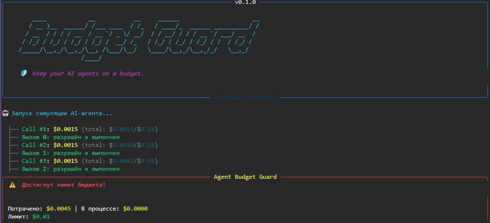

# 🛡️ Agent Budget Guard

> **Stop your AI agents from burning your API budget.** 

`agent-budget-guard` is a lightweight Python library for LangChain that acts as a circuit breaker for autonomous agents. It intercepts LLM calls *before* they are sent and blocks them if the budget is exceeded. It features a **Human-in-the-loop** pause and a beautiful CLI interface.

## 🚨 The Problem
Autonomous agents can easily get stuck in infinite loops. Standard observability tools show you the bill *after* the money is spent. `agent-budget-guard` stops the agent *before* the request hits the API.

## ✨ Features
- **Hard budget limits:** Set a limit in USD (e.g., `$5.00`).
- **Human-in-the-loop:** Pauses and asks for permission to continue when the limit is reached.
- **Thread-safe:** Uses atomic reservations to prevent race conditions.
- **Beautiful CLI:** Powered by `rich`.

## 📦 Installation
```bash
pip install agent-budget-guard
🛠️ Usage
python
from agent_budget_guard import BudgetGuard

# 1. Set a hard limit of $5.00
guard = BudgetGuard(max_budget_usd=5.0, interactive=True)

# 2. Add to your LangChain agent
result = agent.invoke(
    {"input": "Analyze these 100 documents..."},
    config={"callbacks": [guard]}
)

# 3. Get a beautiful report
guard.print_summary()
